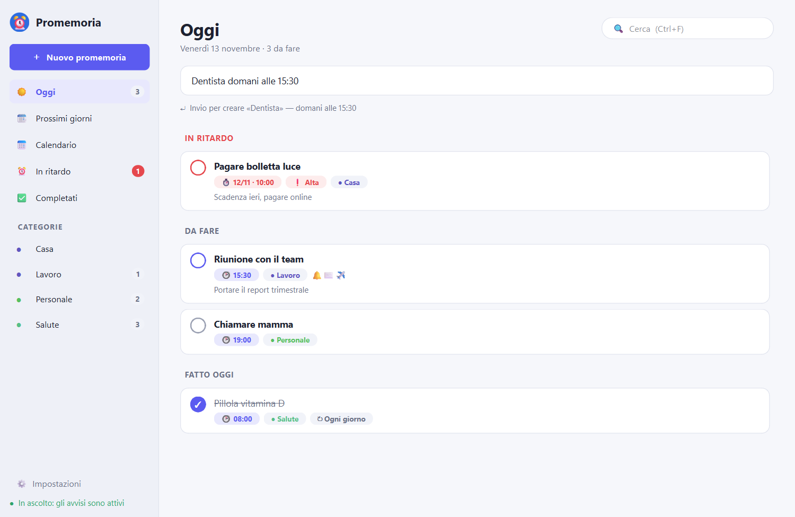

# Promemoria

App di promemoria per Windows: calendario, sveglie, popup e notifiche via **email** e **Telegram**.
Gira in background, parte con Windows e consuma pochissimo (~75 MB di RAM).



## Scarica e usa (senza installare nulla)

1. Vai su **[Releases](https://github.com/RaffaeleSilvestro/promemoria/releases/latest)** e scarica `Promemoria.exe`.
2. Mettilo in una cartella dove resterà (es. `Documenti\Promemoria`) e aprilo con doppio clic.
3. Windows potrebbe mostrare "Windows ha protetto il PC": è normale per le app non firmate → **Ulteriori informazioni → Esegui comunque**.
4. Tasto destro sull'icona nella barra delle applicazioni → **Aggiungi alla barra delle applicazioni**.

Non serve Python né alcun account: ognuno ha i propri dati, salvati solo sul proprio PC
(`%APPDATA%\Promemoria`). Password email e token Telegram sono cifrati con Windows (DPAPI).

## Per sviluppatori: avvio dal codice

```bash
pip install -r requirements.txt
python main.py
```

Oppure doppio clic su `avvia.bat`. `python installa.py` crea logo e collegamenti (Desktop + menu Start).

## Email (Gmail)

1. Attiva la verifica in due passaggi sul tuo account Google.
2. Account Google → Sicurezza → Password per le app → creane una.
3. Impostazioni → Email: utente = tuo indirizzo Gmail, password = quella per le app, poi "Invia email di prova".

## Telegram

1. Su Telegram scrivi a **@BotFather** → `/newbot` → copia il token.
2. Apri il tuo bot e premi Avvia (`/start`).
3. Impostazioni → Telegram: incolla il token, premi "Rileva chat ID", poi "Invia messaggio di prova".

## Funzioni

- Calendario mensile con giorni evidenziati e lista del giorno; vista "Attività" (Oggi, prossimi 7/30 giorni, Scaduti, Completati)
- Ricorrenze: giornaliere, settimanali (con giorni scelti), mensili, annuali, con intervallo e data finale
- Più preavvisi per promemoria (all'ora, 5/10/30 min, 1/3 ore, 1/2 giorni, 1 settimana)
- Popup in primo piano con Fatto / Posticipa; sveglia sonora ripetuta finché non chiudi il popup
- Priorità, categorie, note, ricerca
- Canali per ogni promemoria: popup, sveglia, email, Telegram (con 3 tentativi se manca la rete)

## Dati e sicurezza

- Dati in `%APPDATA%\Promemoria\` (database SQLite + `settings.json`).
- Password email e token Telegram sono cifrati con DPAPI di Windows (leggibili solo dal tuo utente su questo PC).

## Test

```bash
python -m pytest
```

## Interfaccia (v2)

- **Inserimento rapido** in italiano dalla barra in alto, con anteprima mentre scrivi:
  «Dentista domani alle 15:30», «Palestra ogni lunedì alle 18», «Chiama Luca tra 2 ore»,
  «Pagare affitto il 5 dicembre», «Cena stasera», «Pillola ogni giorno alle 8».
  Se non c'è una data, si apre il modulo completo con il titolo già scritto.
- **Barra laterale**: Oggi, Prossimi giorni, Calendario, In ritardo, Completati e le tue categorie, con contatori.
- **Card** raggruppate per giorno: clic sul cerchio = fatto, doppio clic = modifica, icone ✎/🗑 al passaggio del mouse.
- **Annulla** dopo creazione, completamento ed eliminazione (niente più conferme bloccanti).
- **Calendario** con pallini colorati per priorità e anello sul giorno di oggi.
- **Tema chiaro/scuro** automatico come Windows (o forzato in Impostazioni → Generali).
- **Popup** in basso a destra con posticipo in un clic (+10 min, +1 ora, Domani).
- **Canali predefiniti** per i nuovi promemoria (sveglia / email / Telegram) in Impostazioni → Generali.

### Scorciatoie

| Tasti | Azione |
|---|---|
| Ctrl+N | Nuovo promemoria |
| Ctrl+L | Inserimento rapido |
| Ctrl+F | Cerca |
| Ctrl+1 … Ctrl+5 | Oggi / Prossimi / Calendario / In ritardo / Completati |
| Ctrl+, | Impostazioni |
| Ctrl+Invio | Salva nel modulo |

## Barra delle applicazioni e logo

- `python installa.py` crea il logo (stile Promemoria di iPhone) e i collegamenti **Promemoria** sul Desktop e nel menu Start.
- Per fissarla: apri Promemoria → tasto destro sulla sua icona nella barra delle applicazioni → **Aggiungi alla barra delle applicazioni**.
- La **X** nasconde la finestra (niente trattino sulla barra): l'app resta attiva in background, gli avvisi continuano e la riapri cliccando l'icona fissata. Per chiuderla davvero: **⏻ Esci** in basso nella barra laterale.
- Cliccare l'icona quando l'app è già aperta riporta in primo piano la finestra esistente (nessun doppione).
- **Avvio con Windows** attivo di default: all'accesso parte nascosta in background (Impostazioni → Generali per disattivarlo). L'app ricrea da sola la voce di avvio se manca.
- Consumi misurati: ~75 MB di RAM, CPU praticamente nulla (controllo ogni 10 secondi).
- Registro errori: `%APPDATA%\Promemoria\promemoria.log`.

## Creare l'eseguibile

```bash
build_exe.bat
```

Il file finisce in `dist\Promemoria.exe`.

## Licenza

MIT, vedi [LICENSE](LICENSE).
